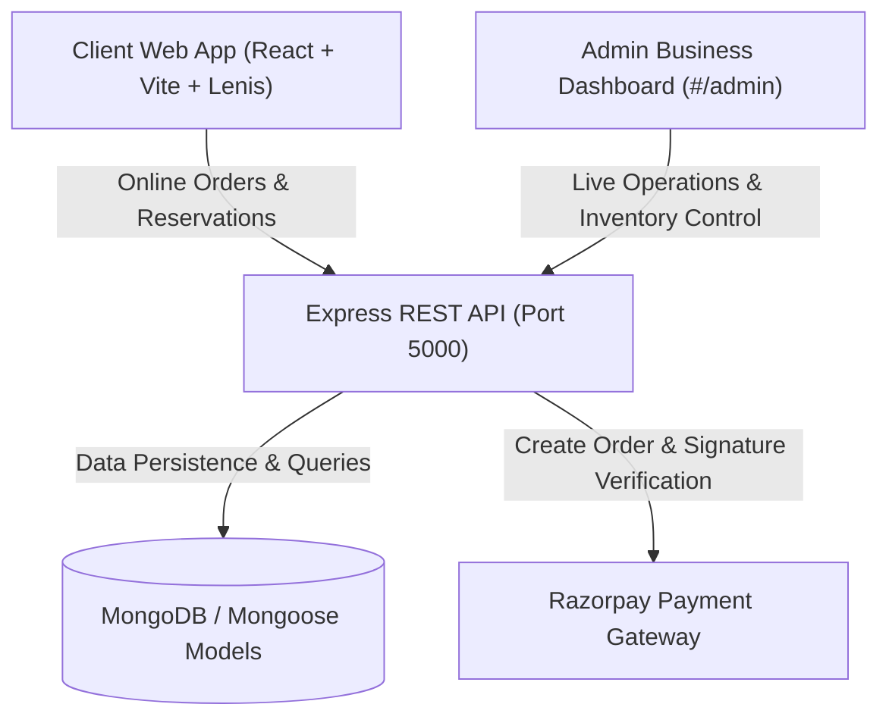

# NOIRÉ Café 2.0 — Full-Stack Café Business Platform

An editorial luxury specialty coffee experience powered by **React 18 + Vite + TypeScript** frontend, **Node.js + Express** backend, **MongoDB / Mongoose** database, **Razorpay Payment Integration**, and an **Executive Operations Dashboard**.

---

## 🌟 Architecture Overview



---

## ☕ Key Functional Modules

### 1. Online Ordering & Real-Time Cart
- Connected directly to `POST /api/orders`
- Auto-generates unique branded order IDs (`NC-YYYYMMDD-XXXX`)
- Server-side price calculation to eliminate client tampering
- Auto-calculates café GST (5%) and item subtotal
- Live status progression: `pending` → `confirmed` → `preparing` → `ready` → `completed` → `cancelled`

### 2. Payment Integration (Razorpay)
- Official Razorpay SDK integration for UPI, Credit/Debit Cards, and Netbanking
- Server-side cryptographic HMAC SHA256 signature verification (`order_id + "|" + payment_id`)
- Secure webhook listener (`POST /api/payments/webhook`)
- Automatic inventory deduction upon confirmed payment verification

### 3. Sanctuary Reservations & Overlap Prevention
- Direct table booking through `POST /api/reservations`
- Table overlap prevention: checks existing active reservations for date and time slot
- Automatic table allocation (`Table T-01` to `Table T-08`)
- Seating areas: *Courtyard Atrium*, *Main Hall*, *North Reading Corner*, *Slow Bar*
- Unique reservation code generation (`NCR-XXXXXX`)

### 4. Executive Admin Dashboard (`#/admin`)
- Accessible via the website navigation, footer, or URL `#/admin`
- **01. Overview:** Today's revenue, active orders, today's reservations, low-stock threshold alert
- **02. Orders:** Live order feed with status progression buttons and itemized receipt modal
- **03. Reservations:** Table management calendar, capacity checker, approval & cancellation
- **04. Menu Management:** Availability toggle (`In Stock` / `Sold Out`), product create/edit modal
- **05. Categories:** Taxonomy and ordering management
- **06. Customers:** Directory with visit counts, lifetime spend, and loyalty tiers
- **07. Inventory & Recipes:** Ingredients tracking with automatic stock consumption per order
- **08. Sales Analytics:** 7-day revenue trend bar chart, best-selling products ranking
- **09. Settings:** Store open/closed status, café coordinates, tax rates, and Razorpay configuration

---

## 🔐 Credentials & Authentication

JWT authentication with role-based access control (RBAC):

| Role | Email | Password |
| :--- | :--- | :--- |
| **Admin** | `admin@noirecafe.ch` | `NoireAdmin2026!` |
| **Lead Barista (Staff)** | `barista@noirecafe.ch` | `Barista2026!` |

> *Quick-fill buttons are provided on the login page for instantaneous testing.*

---

## 🛠️ REST API Reference

| Method | Endpoint | Description | Auth |
| :--- | :--- | :--- | :--- |
| `GET` | `/api/health` | Health check & service status | Public |
| `POST` | `/api/auth/login` | Staff / Admin authentication | Public |
| `GET` | `/api/auth/me` | Fetch active user profile | Bearer Token |
| `GET` | `/api/menu` | List all café menu products | Public |
| `POST` | `/api/menu` | Create a new menu item | Admin |
| `PATCH` | `/api/menu/:id/toggle-availability` | Toggle in stock / sold out | Staff / Admin |
| `POST` | `/api/orders` | Create a new customer order | Public |
| `GET` | `/api/orders` | List orders with status filters | Staff / Admin |
| `PATCH` | `/api/orders/:orderId/status` | Advance order status | Staff / Admin |
| `GET` | `/api/payments/config` | Get public Razorpay Key ID | Public |
| `POST` | `/api/payments/create-order` | Generate Razorpay order | Public |
| `POST` | `/api/payments/verify` | Verify cryptographic signature | Public |
| `POST` | `/api/reservations` | Book table reservation | Public |
| `GET` | `/api/reservations/availability` | Check slot availability | Public |
| `GET` | `/api/reservations` | List table reservations | Staff / Admin |
| `GET` | `/api/inventory` | List stock & low-stock warnings | Staff / Admin |
| `POST` | `/api/inventory/purchase` | Record ingredient restock | Staff / Admin |
| `GET` | `/api/analytics/overview` | Executive KPI metrics | Staff / Admin |
| `GET` | `/api/analytics/sales` | 7-day revenue timeline | Staff / Admin |

---

## 🚀 Getting Started

### 1. Install Dependencies
```bash
# Frontend
npm install

# Backend
cd server
npm install
cd ..
```

### 2. Configure Environment (`server/.env`)
```env
PORT=5000
MONGODB_URI=mongodb://localhost:27017/noire-cafe
JWT_SECRET=noire_cafe_super_secret_jwt_key_2026_luxury_editorial
RAZORPAY_KEY_ID=rzp_test_NoireCafeDemo2026
RAZORPAY_KEY_SECRET=demo_secret_key_noire_cafe_987654
```

> **Note on Database:** If an external MongoDB server is not running on `localhost:27017`, the backend automatically initializes an in-memory development database (`mongodb-memory-server`) with seeded menu, inventory, and staff accounts.

### 3. Run Development Servers
```bash
# Start backend API (Port 5000)
npm run server:dev

# Start frontend (Port 5173)
npm run dev
```

Visit `http://localhost:5173` for the customer experience or `http://localhost:5173/#admin` for the business platform.
